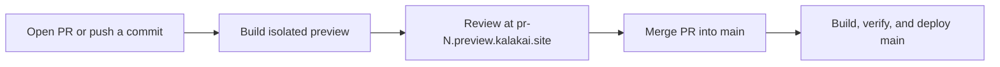

# Kalakai deployment

The VPS polls the public repository approximately every three minutes when idle.
Preview builds use separate containers and sample SQLite databases. The stable
preview URL switches to the new commit only after its health checks pass.
GitHub Actions posts one preview comment per PR and refreshes its build status
after a successful build. The workflow must be merged into the default branch
and GitHub Actions must be allowed in the upstream repository. The periodic
check also runs when the repository does not allow the pull request event.
No GitHub or VPS secrets are required by the workflow.

Live deployment checks that the tip of upstream `main` is exactly the commit
GitHub recorded as the result of a merged PR targeting `main`. Direct pushes do
not trigger deployment. A failed production health check restores the previous
code and assets. A SQLite snapshot is retained for recovery; it is not restored
automatically, to avoid overwriting production writes. Keep migrations
compatible with the previous release during the rollback window.

This setup assumes the existing Kalakai VPS layout (`/srv/kalakai` with
`origin` set to the upstream repo, Nginx and PHP 8.5, and the existing Certbot
webroot). DNS for `*.preview.kalakai.site` must point to the VPS. Install the
scripts in `/opt/kalakai-auto` as root-owned files and create
`/var/lib/kalakai-automation` owned by the deployment user `ubuntu`. Install
Docker with the systemd cgroup driver. Run `kalakai-auto-storage.sh`, apply
`kalakai-auto-network.sh` as root, then build the trusted preview base image
with `kalakai-auto-preview.Dockerfile` tagged `kalakai-preview-base:1`. Run
`kalakai-auto-install-timer.sh` as the deployment user to start syncing.

Use `sudo journalctl -u kalakai-deploy-sync.service -n 100` for build and
release logs. `sudo systemctl stop kalakai-deploy-sync.timer` pauses new sync
runs; it leaves the current production and previews up. Automated previews
have a shared 8 GB disk budget and bounded CPU and memory. Existing previews
#2–#5 stay on their current build until their next commit.
